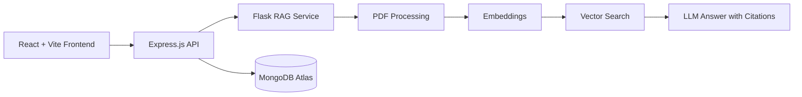

# College RAG System

<div align="center">

**An AI-powered academic assistant for college information, timetables, syllabi, placements, and student support.**

[](https://react.dev/)
[](https://nodejs.org/)
[](https://flask.palletsprojects.com/)
[](https://www.mongodb.com/atlas)

</div>

---

## Overview

College RAG System is a full-stack retrieval-augmented generation application that answers student questions using the college's own PDF documents. It combines a React interface, an Express API, a Flask RAG service, and MongoDB to provide contextual academic assistance.

### Key Features

- **Document-based chat** - Answers questions from indexed college PDFs
- **Citation-aware responses** - Displays source filenames and PDF pages
- **Personalized timetables** - Uses semester and branch preferences for timetable queries
- **Student dashboard** - Keeps profile details and academic preferences
- **Class schedule viewer** - Opens semester-specific timetable PDFs
- **Syllabus assistant** - Finds syllabus information for supported programmes
- **Placement assistant** - Helps students explore placement questions and opportunities
- **Resume review** - Assists with reviewing and improving resumes
- **Persistent chat history** - Stores conversations for signed-in users

---

## How It Works



| Layer | Technology |
|---|---|
| Frontend | React 18, Vite, Axios |
| Backend | Node.js, Express, JWT, Mongoose |
| RAG service | Flask, Gunicorn, LangChain |
| Retrieval | ChromaDB, Sentence Transformers |
| LLM | Groq or Google Gemini |
| Document processing | PyPDF |
| Database | MongoDB Atlas |

---

## Project Structure

```text
college-rag-system/
├── frontend/
│   ├── public/timetables/       # Public timetable PDF files
│   └── src/
│       ├── components/          # Dashboard, classes, placement, and resume UI
│       └── App.jsx
├── backend/
│   ├── data/                    # Placement and other structured data
│   ├── routes/                  # Authentication, chat, syllabus, and placement routes
│   ├── middleware/
│   └── server.js
├── rag-service/
│   ├── data/raw/                # Source PDF documents
│   ├── app.py                   # Flask API
│   ├── ingest.py                # PDF ingestion script
│   ├── rag.py                   # Retrieval and answer generation
│   └── requirements.txt
└── README.md
```

---

## Prerequisites

Make sure the following tools are installed:

- [Node.js](https://nodejs.org/) 18 or later
- [Python](https://www.python.org/) 3.10 or later
- npm
- pip
- A MongoDB Atlas database
- A Groq or Google Gemini API key

---

## Local Setup

### 1. Clone the repository

```bash
git clone https://github.com/Rudhar-cmd/Collage-rag-system.git
cd Collage-rag-system
```

### 2. Configure the RAG service

```bash
cd rag-service
python3 -m venv .venv
source .venv/bin/activate
pip install -r requirements.txt
cp .env.example .env
```

Add the required API key and optional model settings to `.env`, then place source PDFs in:

```text
rag-service/data/raw/
```

Build or refresh the local retrieval data:

```bash
python ingest.py
```

Start the Flask service:

```bash
python app.py
```

The RAG service will be available at `http://127.0.0.1:5001`.

### 3. Configure the Node.js backend

Open a new terminal:

```bash
cd backend
npm install
cp .env.example .env
npm run dev
```

Configure `backend/.env`:

```dotenv
MONGODB_URI=your_mongodb_atlas_connection_string
JWT_SECRET=your_secure_random_secret
PORT=8003
FLASK_RAG_URL=http://127.0.0.1:5001
```

The backend will be available at `http://127.0.0.1:8003`.

### 4. Configure the React frontend

Open another terminal:

```bash
cd frontend
npm install
cp .env.example .env
npm run dev
```

For local development, `frontend/.env` can contain:

```dotenv
VITE_API_URL=http://127.0.0.1:8003
```

Open the URL printed by Vite, usually `http://localhost:5173`.

---

## Environment Variables

### RAG service

| Variable | Purpose |
|---|---|
| `GROQ_API_KEY` | Groq API access |
| `GOOGLE_API_KEY` | Google Gemini API access |
| `CHROMA_PATH` | Directory for the generated vector database |
| `COLLECTION_NAME` | ChromaDB collection name |
| `EMBEDDING_MODEL` | Sentence Transformer model |
| `GEMINI_MODEL` | Gemini model name |

### Backend

| Variable | Purpose |
|---|---|
| `MONGODB_URI` | MongoDB Atlas connection string |
| `JWT_SECRET` | Secret used to sign authentication tokens |
| `PORT` | Express server port |
| `FLASK_RAG_URL` | URL of the RAG service |

### Frontend

| Variable | Purpose |
|---|---|
| `VITE_API_URL` | Public or local Express backend URL |

> Never commit `.env` files, API keys, database credentials, or private college documents.

---

## Timetable and Student Profiles

Timetable PDFs are stored in `frontend/public/timetables/` and copied to `rag-service/data/raw/` for indexing.

Students can select their:

- Semester
- Branch

from **My Dashboard**. The profile is saved in the browser for the signed-in account and is used when a timetable question does not specify either value.

After adding or replacing source documents, restart the RAG service or rebuild the retrieval index with:

```bash
python ingest.py
```

---

## API Reference

### RAG query

```http
POST /api/query
Content-Type: application/json
```

```json
{
  "question": "What is the attendance requirement?",
  "top_k": 3,
  "history": [],
  "student_profile": {
    "semester": "5",
    "branch": "cse"
  }
}
```

Example response:

```json
{
  "answer": "The attendance requirement is documented in the college information.",
  "sources": [
    {
      "source": "college_information.pdf",
      "page": 4
    }
  ]
}
```

Additional backend route groups include authentication, chat history, syllabus, placements, and the health/query proxy endpoints.

---

## Production Deployment

The project can be deployed across three services:

1. Deploy the React frontend as a static Vite application.
2. Deploy the Node.js backend to a service such as Render or Railway.
3. Deploy the Flask RAG service with Gunicorn and persistent storage.

Example RAG production command:

```bash
gunicorn app:app --bind 0.0.0.0:$PORT
```

Set the backend's `FLASK_RAG_URL` to the deployed RAG service URL and configure CORS/environment variables for the frontend origin.

---

## Development Checks

Run the available checks before submitting changes:

```bash
# Frontend
cd frontend
npm run build

# Python RAG service
cd rag-service
python3 -m py_compile app.py ingest.py rag.py

# Git patch
git diff --check
```

---

## Contributing

Contributions are welcome:

1. Fork the repository
2. Create a feature branch
3. Commit the focused change
4. Push the branch
5. Open a pull request

Please keep credentials out of commits and test the complete local setup after changing dependencies or API contracts.

---

## License

This project is licensed for educational use. Add a `LICENSE` file before publishing it as an open-source package.
